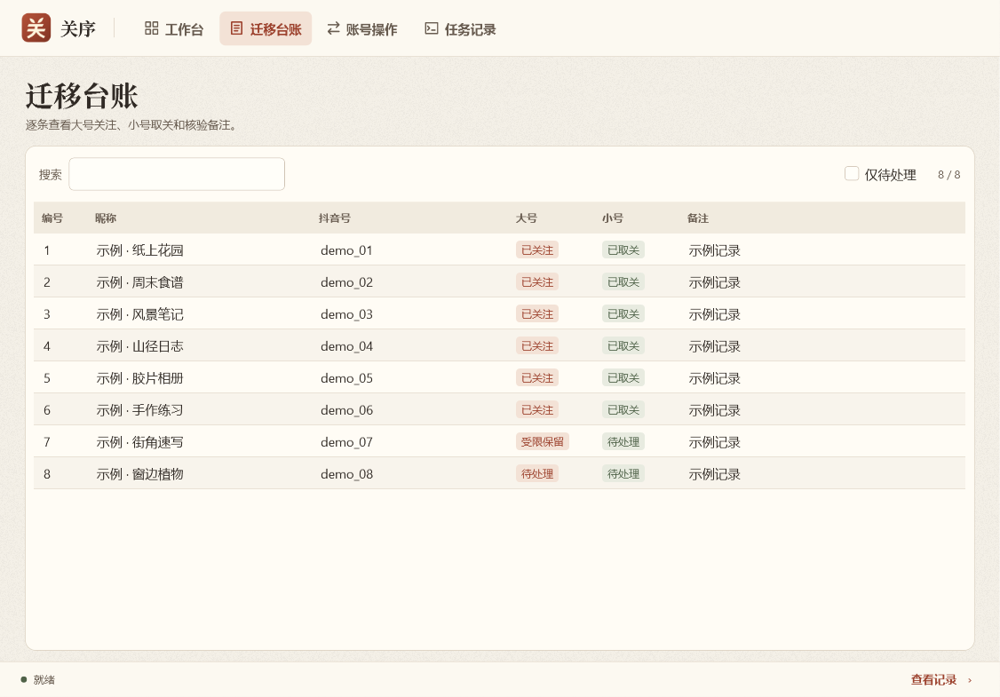

  
  <h1>关序 · Douyin Follow Manager</h1>
  
<strong>简体中文</strong> · <a href="README_EN.md">English</a>

  
<strong>在 Windows 上审阅、整理和迁移自己的抖音关注列表。</strong>

  
从最近一次快照找出需要复核的账号，把决定导出为名单，再逐条核对。

  
<a href="#下载">下载 v0.1.0</a> · <a href="#快速开始">快速开始</a> · <a href="#界面预览">界面预览</a> · <a href="CHANGELOG.md">更新记录</a> · <a href="https://github.com/ElmaTony/douyin-follow-manager/issues">反馈问题</a>

  
  
截图中的账号、数量和迁移结果均为虚构示例。

## 下载

| 平台 | 下载 | 环境 |
| --- | --- | --- |
| Windows x64 | [Windows ZIP](https://github.com/ElmaTony/douyin-follow-manager/releases/download/v0.1.0/douyin-follow-manager-0.1.0-windows-x64.zip) · [SHA-256 校验清单](https://github.com/ElmaTony/douyin-follow-manager/releases/download/v0.1.0/SHA256SUMS.txt) | Node.js 20 或更高版本、Google Chrome、支持 WPF 的 .NET Framework 4.8 |

ZIP 包含已编译的 `关序.exe`、运行脚本和所需的 Playwright 依赖。完整解压到可写目录后启动。源代码和历史版本可在[发行页](https://github.com/ElmaTony/douyin-follow-manager/releases)查看。

## 核心功能

| 入口 | 可以做什么 |
| --- | --- |
| 工作台 | 查看最近一次大号关注快照、迁移完成数、受限保留数和自检报告。 |
| 审阅画廊 | 分别查看低作品账号、停更超过 30 天的账号，以及快照间昵称或内容主题有变化的账号。可查看封面，标记保留或取关，导出决定名单。 |
| 迁移台账 | 搜索账号、筛选待处理记录。迁移会先复核大号关注成功，再处理小号取关，最后核对两端状态。 |
| 账号操作 | 在本地预览名单，再在线核对；执行取关需要单独确认。登记表按日期对比完整的关注列表，保留名单和异常账号有单独保护。 |
| 任务记录 | 查看当前任务、逐条输出与失败原因，可中止正在运行的任务。 |

## 快速开始

1. 安装所需的 [Node.js](https://nodejs.org/) 和 [Google Chrome](https://www.google.com/chrome/)，解压 Windows ZIP。
2. 在解压后的目录打开 PowerShell，运行下方第一条命令。浏览器打开后登录用于审阅的**目标大号**，回到终端，按提示核对账号编号。只有需要双账号迁移时才运行第二条命令，绑定**来源小号**。

   ~~~powershell
   node scripts/setup.mjs main
   node scripts/setup.mjs alt
   ~~~

3. 双击 `关序.exe`，在工作台选择「在线更新审阅数据」。第一次采集完成后即可打开画廊。内容主题变化需要两次快照，昵称还可以与迁移台账比对。
4. 在画廊审阅后导出 `decisions.txt`，到「账号操作」选择该文件并预览。只会将明确标记为「取关」的记录列为候选。增量迁移会修改两边的关注关系，在核对来源和目标账号后再启动。

## 界面预览

展开查看迁移台账（示例数据）

## 常见问题

**首次启动为什么没有画廊？** 画廊由自己的关注快照生成。绑定大号并完成首次在线更新后，工作台会显示每个画廊的账号数。「从快照重建」可以在已有数据时离线重新生成页面。

**账号、登录状态和审阅记录在哪里？** `data/` 保存本机绑定、快照、台账和导出报告。`profiles/` 是本工具专用的浏览器目录，保存登录状态和画廊标记。这些目录仅供本人使用；反馈问题时请使用虚构数据。更换整组账号时，在新目录解压程序并重新绑定。

**看到“身份不符”或遇到验证怎么办？** 先查看任务记录，确认绑定的是预期账号，并在官方网页完成所需验证。操作依赖抖音网页与账号权限，无法核实时应保留当前台账，再按实际状态复核。

**Chrome 安装在自定义位置？** 可将 `GUANXU_CHROME` 环境变量设为本机 `chrome.exe` 的完整路径，然后从同一个终端启动关序。

## 开发与构建

~~~powershell
git clone https://github.com/ElmaTony/douyin-follow-manager.git
cd douyin-follow-manager
npm ci
npm test
powershell.exe -NoProfile -ExecutionPolicy RemoteSigned -File desktop/build.ps1
node scripts/run.mjs check --browser
~~~

`npm test` 使用模拟账号与页面，覆盖身份不符、状态未知、名单保护、分页中断及快照发布恢复。`check --browser` 只打开本地测试页。构建 Windows ZIP 可运行 `powershell.exe -NoProfile -ExecutionPolicy RemoteSigned -File desktop/package.ps1`。Playwright Core 的许可证和第三方声明随依赖一同提供。

关序是独立的桌面工具，与抖音官方无隶属关系。
