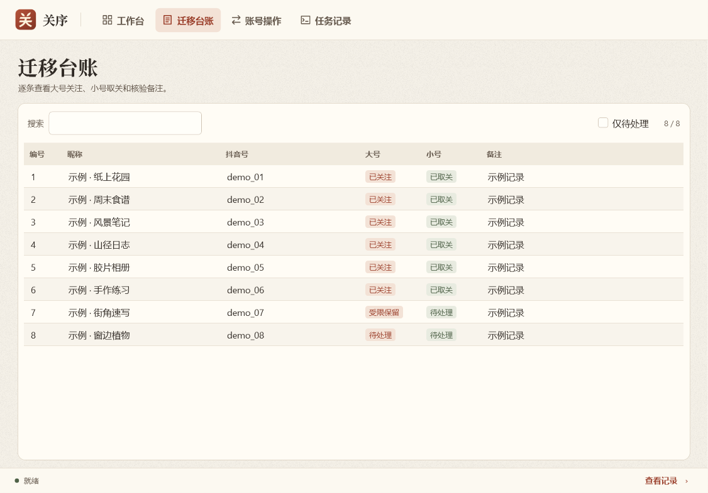

  
  <h1>Guanxu · Douyin Follow Manager</h1>
  
<a href="README.md">简体中文</a> · <strong>English</strong>

  
<strong>Review, organize and transfer your own Douyin follows on Windows.</strong>

  
<a href="#download">Download v0.5.1</a> · <a href="#quick-start">Quick start</a> · <a href="CHANGELOG.md">Changelog</a> · <a href="https://github.com/ElmaTony/douyin-follow-manager/issues">Issues</a>

  
  
All accounts, counts and migration results shown here are fictional. The application interface is in Chinese.

## Download

| Platform | Package | Requirements |
| --- | --- | --- |
| Windows x64 | [Windows ZIP](https://github.com/ElmaTony/douyin-follow-manager/releases/download/v0.5.1/douyin-follow-manager-0.5.1-windows-x64.zip) · [SHA-256 checksums](https://github.com/ElmaTony/douyin-follow-manager/releases/download/v0.5.1/SHA256SUMS.txt) | Node.js 20+, Google Chrome and .NET Framework 4.8 with WPF |

Extract the entire ZIP to a writable folder. It includes the compiled application, its scripts and the Playwright dependency. [All releases](https://github.com/ElmaTony/douyin-follow-manager/releases).

## Features

| View | What it does |
| --- | --- |
| Dashboard | Shows the latest local snapshot, migration progress and diagnostic results. |
| Review galleries | Browse accounts with few posts, accounts inactive for over 30 days and accounts whose names or caption topics have changed. Mark authors and confirm unfollows inside a gallery. |
| Migration ledger | Search individual accounts and filter pending work. The tool verifies the destination follow before removing a follow from the source account. |
| Account actions | Preview a decision list locally, check it online, then confirm execution separately. Compare complete dated snapshots to maintain an unfollow register. |
| Task log | Read progress and failure details, or stop an active task. |

## Quick start

1. Install [Node.js](https://nodejs.org/) and [Google Chrome](https://www.google.com/chrome/), then unpack the ZIP.
2. Open PowerShell in the extracted folder. Run `node scripts/setup.mjs main` to sign in to the destination account in the browser. Return to the terminal and confirm the displayed account number. If you plan to transfer follows, run `node scripts/setup.mjs alt` to bind a separate source account.
3. Open `关序.exe` and select **在线更新审阅数据** to collect your first snapshot. If collection is interrupted, run the update again within six hours. It rechecks the following list and retrieves missing works or accounts whose work count changed. Comparing caption topics requires two snapshots.
4. Combine category and decision filters, search former names and captions, sort by inactivity or follower count, and undo the last mark. After collecting two snapshots, **对比上次快照** writes a per-account change report to `data/snapshot_changes.csv`.
5. Mark authors with **待取关** on cards or in the cover viewer. Open **处理待取关** to review the deduplicated selection across all three galleries. Uncheck anyone you want to defer. Check the names and account IDs, then select **确认取关这 N 位**. You can continue reviewing and switch galleries while the review browser stays open.
6. Each result is shown in the gallery. Authors verified as unfollowed are recorded locally and removed from pending work and exports. Deferred selections persist across galleries for the same snapshot and decision. Use **全不选** to choose a small subset or **只核对上批未完成项** to retry only unresolved authors. Reopening a desktop-launched gallery restores the last batch result. On future migrations the register blocks a new destination follow for a previously unfollowed account. File imports remain available under **账号操作 → 从文件取关**, and you can still export decisions by scope.

## Reviewing large lists

Combine **只看本轮变化** (changes since the previous snapshot) with the unmarked filter. **多画廊命中** lists authors who appear in more than one gallery. A card can open that same author in the other gallery.

Expand recent works to open original posts, or mark a decision in the cover viewer and continue to the next unmarked author with a cover. Inactivity uses completed days. Missing dates, limited visibility and conflicting counts are labeled for review. Caption shifts require evidence from multiple captions.

Open one or five profiles at a time. The three galleries share profile delivery history for the current snapshot. Enable **复用主页标签页** in a desktop-launched gallery to reuse a tab, or Ctrl-click or middle-click for a separate comparison tab. From the cover viewer you can open a profile, skip an author, or undo and return to the same work. Returning to a gallery restores your reading position.

## Preview

Migration ledger with fictional accounts

## FAQ

**Where is my data?** The `data/` folder holds local account bindings, snapshots, reports and the ledger. The dedicated `profiles/` folders hold browser sessions and review marks. Keep these folders private. Use a fresh program directory when switching to a different set of accounts.

**Why are the galleries unavailable?** Bind the destination account and complete an online update. Existing snapshots can be rebuilt offline. Platform changes or account restrictions can interrupt collection. See the task log for the specific failure.

**How do I select a browser?** For a custom Chrome installation, set `GUANXU_CHROME` to the full path of `chrome.exe` and launch the application from the same terminal.

## Development

~~~powershell
git clone https://github.com/ElmaTony/douyin-follow-manager.git
cd douyin-follow-manager
npm ci
npm test
powershell.exe -NoProfile -ExecutionPolicy RemoteSigned -File desktop/build.ps1
node scripts/run.mjs check --browser
~~~

The tests use simulated accounts and pages. The optional browser check opens a local page. Run `desktop/package.ps1` with Windows PowerShell to build the ZIP. Playwright Core includes its license and third-party notices.

Guanxu is an independent project and is unaffiliated with Douyin.
